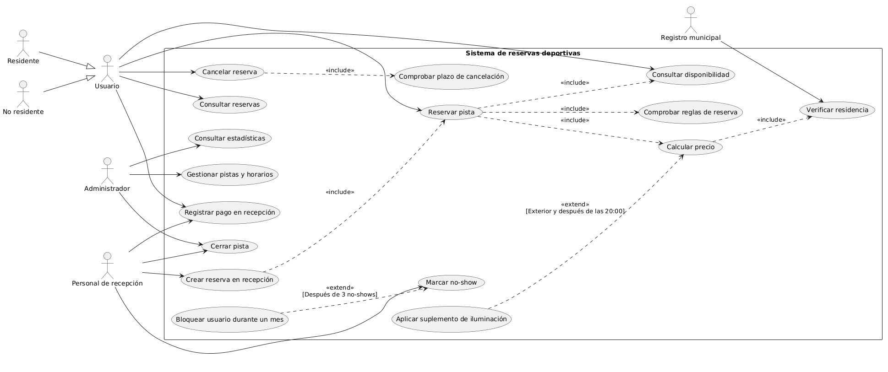

# 3. Use cases

## 3.1. Use case diagram

El diagrama representa los actores principales y las funcionalidades del sistema de reservas deportivas.

## 3.2. Specification: Book a court

| Field | Content |
|---|---|
| **ID and name** | UC-01: Reservar una pista |
| **Actors** | Usuario (residente o no residente), Personal de recepción |
| **Preconditions** | El usuario está identificado. La pista está disponible y el horario está abierto para reservas. El usuario no tiene tres reservas activas ni está bloqueado. |
| **Main flow** | 1. El usuario selecciona el deporte. 2. El sistema muestra las pistas disponibles. 3. El usuario selecciona una pista, una fecha y una hora. 4. El sistema comprueba la disponibilidad. 5. El sistema comprueba que el usuario no supera el límite de tres reservas activas. 6. El sistema calcula el precio según las tarifas aplicables. 7. El usuario confirma la reserva. 8. El sistema registra la reserva con el estado pendiente de pago. 9. El sistema muestra la confirmación de la reserva y las instrucciones para pagar en recepción. |
| **Alternative flows** | 2a. No hay pistas disponibles: el sistema informa al usuario y permite elegir otro horario. 4a. La pista ya está reservada: el sistema solicita seleccionar otra hora. 5a. El usuario ya tiene tres reservas activas: el sistema rechaza la nueva reserva. 5b. El usuario está bloqueado por tres no-shows: el sistema impide realizar la reserva. |
| **Postconditions** | La reserva queda registrada correctamente y el horario queda ocupado. El pago permanece pendiente hasta que se realice en recepción. |

## 3.3. Specification: Register payment at reception

| Field | Content |
|---|---|
| **ID and name** | UC-02: Registrar el pago en recepción |
| **Actors** | Personal de recepción, Usuario |
| **Preconditions** | Existe una reserva válida. El usuario acude a recepción para pagar antes de utilizar la pista. |
| **Main flow** | 1. El usuario proporciona los datos de su reserva. 2. El empleado de recepción busca la reserva en el sistema. 3. El sistema muestra los datos de la reserva y el importe pendiente. 4. El empleado solicita el método de pago. 5. El usuario paga en efectivo o con tarjeta. 6. El empleado confirma el pago en el sistema. 7. El sistema registra el importe, el método y la fecha del pago. 8. El sistema actualiza el estado de la reserva a pagada. 9. El sistema muestra la confirmación del pago. |
| **Alternative flows** | 2a. No se encuentra la reserva: el sistema informa al empleado y solicita comprobar los datos. 4a. El usuario no puede pagar: la reserva permanece pendiente de pago. 5a. El pago con tarjeta es rechazado: el sistema informa del error y permite utilizar otro método de pago. |
| **Postconditions** | El pago queda registrado correctamente y la reserva aparece como pagada. |

