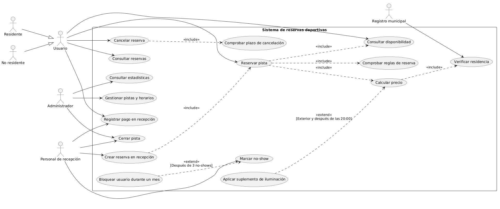
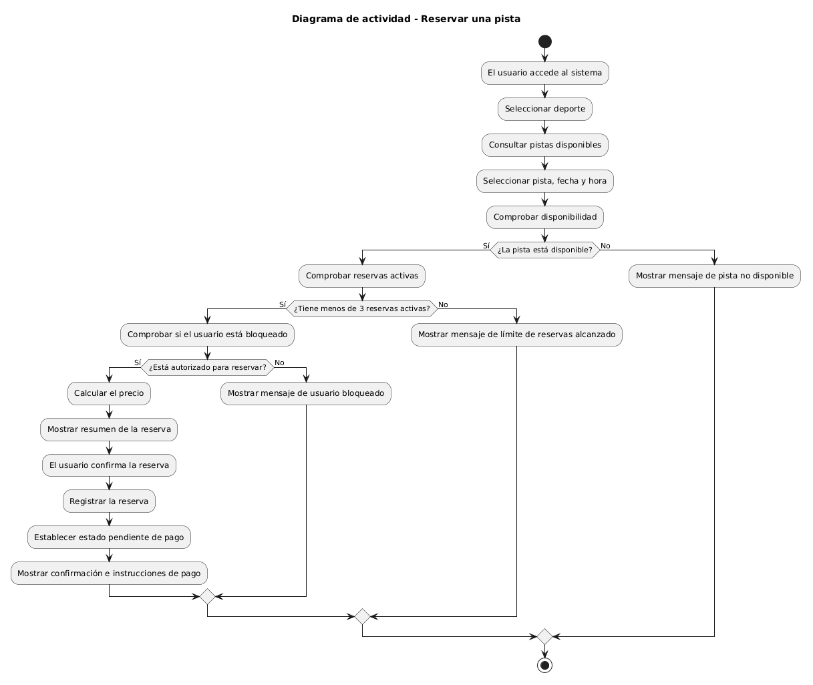
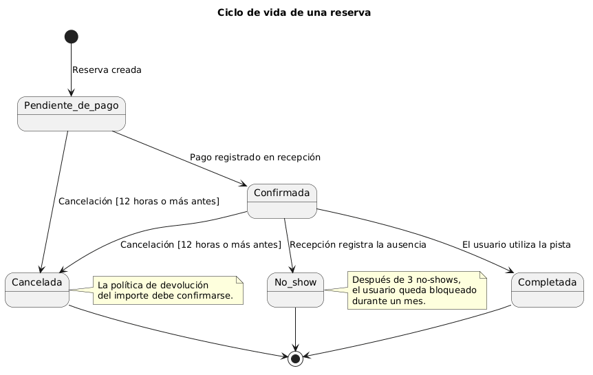
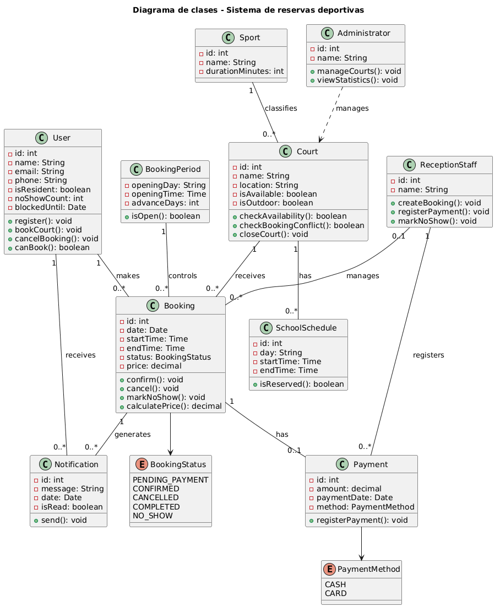

# Assignment 5.T1: Sports centre booking analysis

- **Student:** Omar Bejaji
- **Group:** 1st DAW
- **Variant:** B

## Contents

| Part | File |
|------|------|
| 1. Analysis of the dossier | [1-analysis.md](1-analysis.md) |
| 2. Requirements specification | [2-srs.md](2-srs.md) |
| 3. Use cases | [3-use-cases.md](3-use-cases.md) |
| 4. Activity diagram | activity-booking.png |
| 5. State and class diagrams | state-booking.png, class-booking.png |
| 6. Review of the AI-generated analysis | [6-ai-review.md](6-ai-review.md) |
| Self-assessment | [self-assessment.md](self-assessment.md) |

## Diagrams

### 1. Use case diagram

### 2. Activity diagram: Book a court

### 3. State machine diagram

### 4. Class diagram

